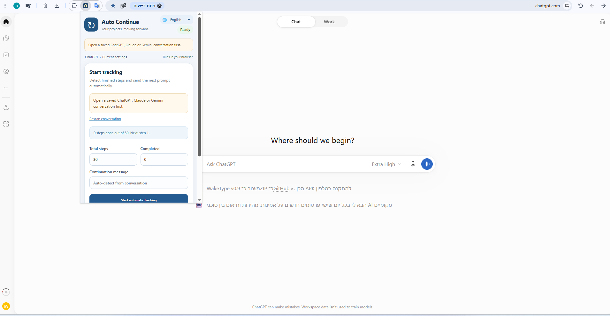
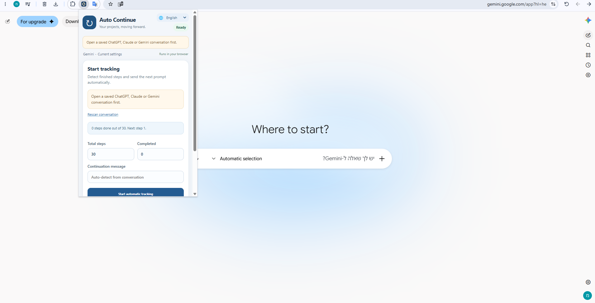
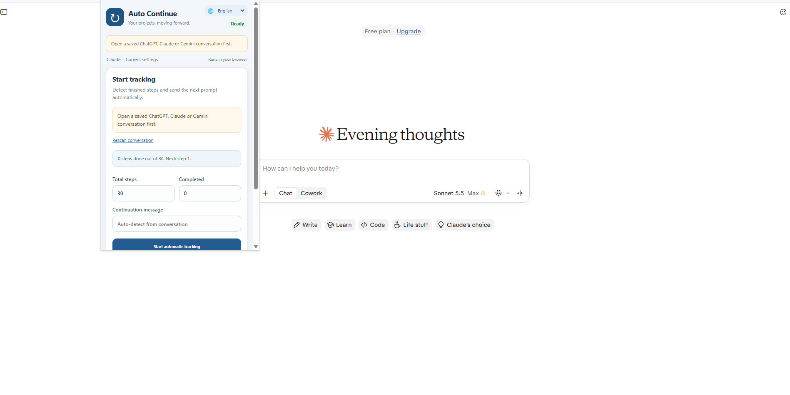

# Auto Continue 🚀

**Keep your AI projects moving — automatically.**

Auto Continue is a browser extension for Chrome and Edge that helps you manage multi-step AI projects without manually typing “continue” after every completed step.

Set your goal, choose the number of stages, and let Auto Continue monitor progress, send continuation messages, and stop when the project is complete.

## ✨ Features

- 🔄 **Automatic continuation** — Keeps multi-step conversations moving.
- 🧠 **Smart stage tracking** — Detects progress and helps prevent unnecessary messages.
- 🖥️ **Multiple chats** — Tracks different projects independently across browser tabs.
- 🌍 **Multilingual interface** — English, Hebrew, Arabic and Spanish, with automatic RTL/LTR support.
- 🌙 **Long-running workflows** — Progress recovery, safety checks and experimental project checkpoints.
- ⚙️ **Flexible AI settings** — Doesn't force a particular model or reasoning level.
- 🔑 **No separate API key required.**

## Installation

1. Download the ZIP from [Releases](../../releases/latest) and extract it.
2. In Chrome, open `chrome://extensions`; in Edge, open `edge://extensions`.
3. Enable Developer mode, select **Load unpacked**, and choose the extracted `AUTO_CONTINUE_CHROME_LANGUAGE_FIXED` folder containing `manifest.json`.

## 🤖 Compatibility

ChatGPT is the primary supported platform. Experimental in-chat support is also included for Claude and Gemini.

## ⚠️ Important

Auto Continue uses browser interface automation, so changes to AI websites may affect compatibility. Automated tests have passed in simulated environments, but this release has not yet been fully validated on live AI accounts. Overnight operation and automatic transfers between chats are not guaranteed.

**Spend less time repeating yourself. Spend more time creating.**

## Screenshots

### ChatGPT

### Gemini

### Claude

